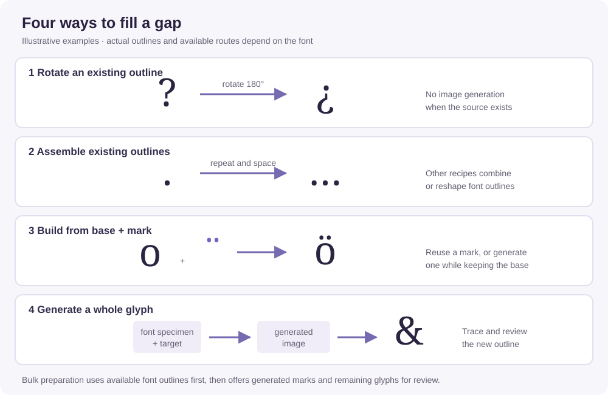

# Font Filler

Font Filler is a personal prototype for filling gaps in a static font. It inspects a font against a defined character set, looks for ways to make missing characters from outlines already in that font, and offers AI-generated candidates where reuse is not available. You can work on one character at a time or prepare and review a batch, then download a modified copy.

The goal is a useful starting point, not an automatically finished typeface. Generated outlines, spacing, accent placement, and character identity all need visual review.

## How the workflow fits together

1. **Intake:** Upload one font and confirm that you have permission to modify it and send a rendered specimen to the generation provider.
2. **Triage:** The app checks its supported character map for missing or empty outlines and identifies usable source outlines and accent marks in the font.
3. **Reuse first:** For supported shapes, it can rotate or assemble existing outlines, or build an accented letter from its original base and an existing mark. Bulk preparation applies these recipes before requesting AI images.
4. **Generate the remaining pieces:** When a buildable accented letter lacks a usable mark, AI can generate the mark while the original base is retained. In bulk, one reviewed mark can serve multiple letters. Other remaining characters can be generated as whole glyphs.
5. **Review and export:** Inspect candidates and placement, add accepted results to the browser workspace, and download the modified font. The original upload is not overwritten.

## Font intake and triage

Upload a static `.ttf` with TrueType outlines or `.otf` with CFF outlines, up to 2.5 MB. The font must have a usable character map. Variable fonts, web fonts, CFF2, and CID-keyed CFF are not supported. The browser also needs to be able to display the uploaded font.

The app checks printable ASCII characters, a selection of punctuation and symbols, and selected precomposed lowercase and uppercase accented letters. It treats a character as missing if its mapping is absent or its glyph has no visible outline. This is a check against the app's character map, not a full Unicode or language-coverage audit. The map also allows selecting a present character for an individual replacement.

For accented letters, triage checks whether the base letter exists and whether a suitable mark can be found. Above-mark letters based on lowercase `i` or `j` also require a safely separable dot. If the base is missing or that dot cannot be separated, the individual accent-building route is unavailable. A visible `H` or `O` is needed to estimate size for whole-character construction.

## Routes for filling gaps



These examples illustrate the routes; they are not renderings from a particular font. The period-to-ellipsis and base-plus-diaeresis examples are also exercised by the reuse and accent tests.

### 1. Rotate an existing outline

When the upright character is available, the app rotates `?` or `!` to make `¿` or `¡`. This uses the font's own outline and does not call the image-generation API.

### 2. Assemble existing outlines

The app can make selected punctuation and symbols from outlines already in the font, without image generation. For example, it can repeat a period for an ellipsis, reshape a hyphen for dashes, or use comparison signs for guillemets. Other recipes use a period for a bullet; a plus, hyphen, and period for certain math symbols; or a lowercase `o` for `º`. One curly double quote can also be rotated to make its counterpart.

### 3. Build from a base and mark

The app can build supported accented letters from the original base and a suitable mark in the font. The supported families are acute, grave, circumflex, tilde, diaeresis, ring, macron, breve, caron, dot above, double acute, cedilla, ogonek, dot below, and comma below. Coverage is a selected set of letters in each family, not every possible combination. Reusing a mark does not call the image-generation API.

Accent source selection generally prefers a suitable existing accent or a mark extracted from another letter. Some families have additional fallbacks: for example, an acute may come from a mirrored grave or rotated quote; a period can provide a dot, a hyphen a macron, a flipped circumflex a caron, or a lowercase `o` a ring. Diaeresis can also draw on suitable letter dots or punctuation. Special forms, including side carons and the mark above `ģ`, have their own source checks. The app reports the chosen source in the individual workflow; availability depends on the outlines in the uploaded font.

#### Generate a mark when needed

If a supported accented letter has a usable base but no suitable existing mark, the individual workflow offers an AI-generated mark. You can also try an AI accent when an existing mark was found. The app traces the generated mark and places it on the original base, rather than regenerating the entire letter.

Accent previews provide size and horizontal and vertical position controls. The resulting letter inherits the base advance and available pair kerning. The app checks for overhang, potential collisions with floating marks, and possible disconnection of attached marks. It may nudge a default placement to address a check and flags the result for review. These checks are approximate; manual adjustments are checked without being overridden.

### 4. Generate a whole character

For a character without an applicable reuse or accent-building route, the individual workflow generates a whole glyph from a rendered font specimen. The image is traced into an outline and scaled and spaced using estimates from the font. Size, spacing, and vertical position can be adjusted in the individual preview. Fixed-pitch fonts retain a fixed advance for these constructions.

The result may not match the intended character or the typeface perfectly. Inspect its shape, proportions, spacing, and clipping before accepting it.

## Working one character at a time

1. Upload the font, confirm permission, and select a character in the map. Missing or empty characters are highlighted; present characters can also be selected for replacement.
2. Create a preview. The app chooses an applicable accent, outline-reuse, or inverted-character route; otherwise it generates a whole glyph. For an accent with an existing source, you can choose to try an AI mark instead.
3. Inspect the preview and adjust the available controls. Generate another candidate where offered.
4. Choose **Use this character in workspace** to incorporate the preview into the current font. Select another character and repeat, or continue with bulk preparation.
5. Download the workspace font to keep your changes.

## Bulk preparation and review

Bulk work uses the same browser workspace as individual work:

1. Choose **Prepare missing characters** after uploading and confirming permission. The app walks the missing supported characters and builds eligible inverted marks, outline recipes, and accented letters from existing sources. It reports additions and placement warnings. This step does not request AI images.
2. For remaining buildable accented letters that lack a mark, the app groups letters by the exact mark needed. It generates isolated marks first in 3×3 grids, with separate groups for side carons and the inverted mark used by `ģ`. One accepted mark can build multiple eligible letters, including both cases when applicable.
3. The other remaining characters in the supported map are offered as whole-glyph candidates in 3×3 or 4×4 grids. This includes accented characters that could not enter a buildable mark group, such as those missing a usable base. Whole-glyph generation does not preserve their original base.
4. Review each candidate for identity, clipping, shape, and style. Select the marks and glyphs to add; regenerate or discard individual candidates as needed. Marks are applied before whole glyphs, and accepted candidates update the workspace. A rejected or unusable mark leaves its associated letters missing.
5. Inspect the resulting font and placement, then download it. Bulk size and spacing are estimates. Grid separators look for low-ink boundaries and warn about possible clipping, but there is no OCR or automatic verification of character identity.

Requests run sequentially in the browser, so keep the page open. If a later request fails, completed candidates remain available. Reloading the page discards the in-progress workspace and candidates; download the font to retain the work.

## Generation, privacy, and limits

The current font and candidates live in the browser session and are sent to the backend for processing. When generating, a rendered font specimen is sent to fal; generated images are traced into font outlines. API use may incur charges. The default is GPT Image 1.5 Edit on fal with low output quality and low input fidelity.

A Cloudflare Worker and D1 database enforce a shared limit of 100 generation attempts per Pacific calendar day across preview and production. Failed attempts count, and generation fails closed if the counter is unavailable. Each grid request and regeneration is an attempt. The interface shows a rough bulk estimate; retries and token charges can increase the cost.

The exported font has a distinct family name and retains the existing font metadata apart from naming changes and the modifications needed to add the glyphs. Review it in the software and contexts where you intend to use it. The hosted version requires Vercel Authentication; GitHub Pages alone cannot run the Python backend.

## Run locally

Requires Python 3.10+, a fal API key with image-generation access, and the rate gate secret.

```sh
python3 -m venv .venv
source .venv/bin/activate
pip install -r requirements.txt
export FAL_KEY="your-fal-api-key"
export RATE_GATE_SECRET="your-rate-gate-secret"
python app.py
```

Open http://127.0.0.1:5050. The keys stay on the server and are not sent to the browser. The experiment is in `experiment/`. Font files are excluded from the repository; supply your own test fonts in `testFonts/` when needed.
